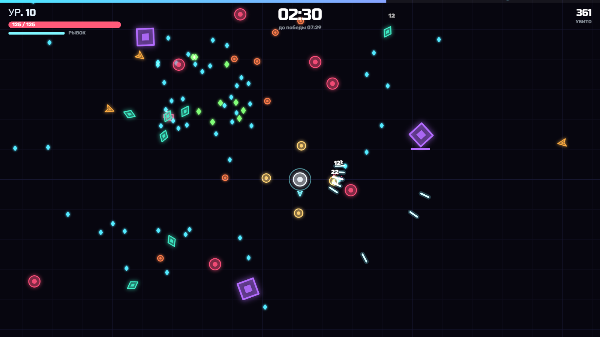
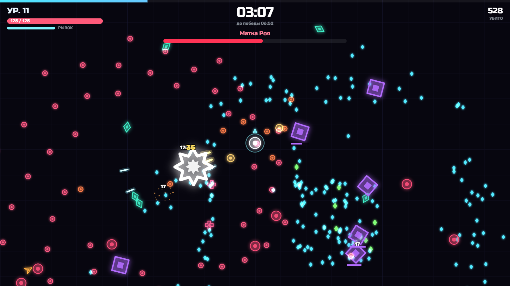
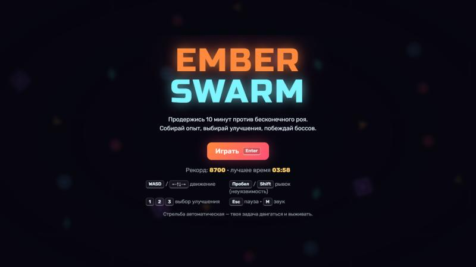

# Ember Swarm

Аркадный roguelite на выживание в браузере. Продержись 10 минут против бесконечного роя, собирай опыт, собирай свою сборку из улучшений и победи трёх боссов.

Написано на чистом JavaScript и Canvas 2D, **без движка и без зависимостей**. Вся графика рисуется кодом, все звуки синтезируются через WebAudio. В игре нет ни одного файла с картинками или звуком.

<!-- После публикации вставь сюда ссылки:
**[▶ Играть в браузере](https://ИМЯ.github.io/ember-swarm/)** · [itch.io](https://ИМЯ.itch.io/ember-swarm)
-->



| Босс | Главное меню |
|---|---|
|  |  |

## Как запустить

- Открой `index.html` двойным кликом. Сервер не нужен.
- Режим разработчика: добавь к адресу `?debug`. Появятся счётчик FPS и горячие клавиши:
  - `K` — убить всех;
  - `L` — новый уровень;
  - `T` — перемотать на 30 секунд;
  - `B` — вызвать босса;
  - `G` — бессмертие.

## Управление

| Клавиша | Действие |
|---|---|
| WASD / стрелки | движение |
| Пробел / Shift | рывок: короткая неуязвимость, можно проскочить сквозь врагов и пули |
| 1 / 2 / 3 или клик | выбор улучшения |
| Esc / P | пауза |
| M | звук |

Стрельба автоматическая, по ближайшему врагу и с упреждением. Задача игрока — двигаться, уворачиваться и выбирать улучшения.

## Что в игре

- **6 типов врагов** с разным поведением:
  - ползун;
  - быстрый дротик;
  - бронированный громила;
  - плевун: держит дистанцию и стреляет;
  - делитель: при смерти распадается на осколки;
  - босс.
- **3 босса** (на 3, 6 и 9 минуте), у каждого три атаки: кольцо пуль, спираль и призыв миньонов.
- **15 улучшений**, включая два дополнительных оружия:
  - «Сателлиты» — сферы на орбите вокруг игрока;
  - «Импульс» — ударная волна.
  У каждого улучшения несколько уровней, а урон усиливает всё оружие сразу, поэтому сборки получаются разными.
- **Директор спавна:** сложность растёт плавно. Со временем врагов становится больше, у них больше здоровья, открываются новые типы. Каждые 50 секунд рой окружает игрока кольцом.
- **Подбираемые предметы:** кристаллы опыта трёх номиналов, аптечка и магнит, который притягивает весь опыт на карте.
- **Рекорд** сохраняется в браузере.

## Техническая часть

| Задача | Решение | Где |
|---|---|---|
| Сотни врагов без просадки FPS | Spatial hash (сетка 64 px): пули и враги проверяют столкновения только с соседями, а не со всеми подряд. ~480 врагов обрабатываются примерно за 0.5 мс на кадр | `src/utils.js` |
| Дорогое неоновое свечение | Каждая фигура со свечением (`shadowBlur`) рисуется один раз в offscreen canvas и кэшируется. Дальше один враг стоит один `drawImage` | `src/sprites.js` |
| Толпа не слипается в одну точку | Мягкое расталкивание соседей с учётом массы: громилу двигать труднее | `src/entities.js` |
| Стрельба попадает по бегущим врагам | Прицел с упреждением: учитывается скорость цели и время полёта пули | `Player.updateGun` |
| Баланс без правки логики | Все числа собраны в одном файле. Улучшения и враги описаны данными, новый тип добавляется одной записью | `src/config.js`, `src/upgrades.js` |
| Ощущение от игры | Тряска экрана через «trauma», hit-stop при уроне, частицы, всплывающие цифры урона, замедление в конце забега, звук кристаллов повышается при серии | `src/fx.js`, `src/game.js` |
| Звук без файлов | Синтез через WebAudio: осцилляторы, шум и фильтры. Частые звуки ограничены по времени, чтобы не сливаться в шум | `src/audio.js` |

### Архитектура

```
index.html        разметка меню и подключение скриптов
style.css         оформление меню и карточек
build.ps1         сборка zip для itch.io
docs/             скриншоты для README
src/
  config.js       все числа баланса, типы врагов
  utils.js        математика, SpatialHash, сохранение рекорда
  input.js        клавиатура: удерживаемые и только что нажатые клавиши
  audio.js        синтезированные звуки
  sprites.js      кэш светящихся фигур
  fx.js           частицы, кольца, цифры урона, тряска
  entities.js     игрок, враги (включая ИИ босса), пули, кристаллы
  upgrades.js     улучшения как данные + выбор трёх случайных
  director.js     кто, где и когда появляется
  hud.js          интерфейс поверх игры (canvas)
  ui.js           меню, пауза, карточки, итоги (DOM)
  game.js         конечный автомат состояний, игровой цикл, бой, отрисовка
```

Состояния игры: `menu → playing ⇄ paused / levelup → ending (замедление) → over`.

Скрипты подключаются обычными тегами `<script>`, без ES-модулей. Поэтому игра открывается прямо из файла, без локального сервера.

## Публикация

### GitHub Pages (ссылка «играть в браузере»)

1. Залей репозиторий на GitHub.
2. Открой **Settings → Pages**. В поле **Source** выбери `Deploy from a branch`, затем ветку `main` и папку `/ (root)`.
3. Через минуту игра будет доступна по адресу `https://<имя>.github.io/ember-swarm/`.

### itch.io

1. Собери архив:
   ```
   powershell -ExecutionPolicy Bypass -File build.ps1
   ```
   Появится файл `dist/ember-swarm.zip`. В нём только файлы игры, `index.html` лежит в корне.
2. На itch.io: **Create new project** → **Kind of project: HTML** → загрузи zip → отметь **This file will be played in the browser**.
3. Размер окна: 1280 × 720, включи **Fullscreen button**.

## Идеи для развития

- Управление на телефоне (виртуальный джойстик).
- Мета-прогрессия между забегами: валюта и постоянные улучшения.
- Несколько персонажей со стартовым оружием.
- Эволюция оружия: два улучшения на максимуме дают новое.
- Таблица рекордов онлайн.

## Лицензия

MIT, подробности в файле [LICENSE](LICENSE).
